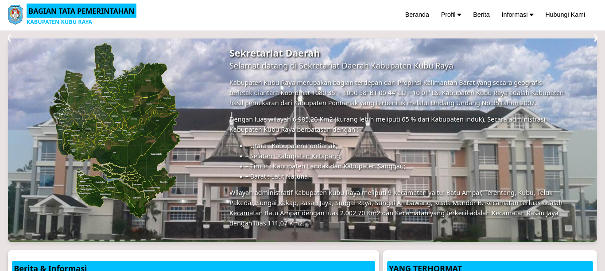
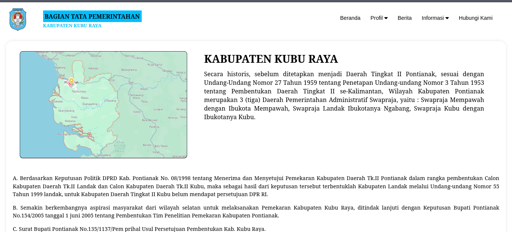
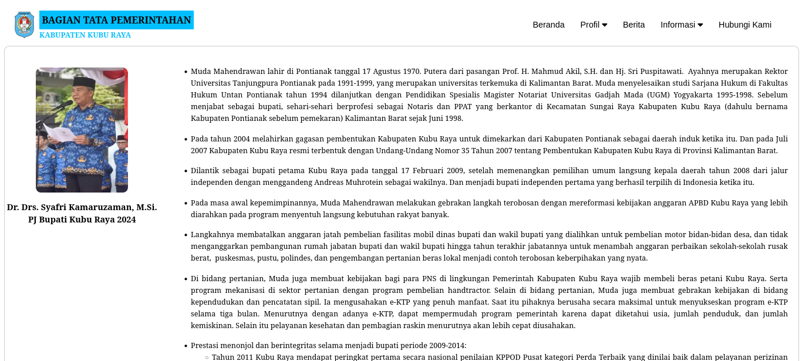
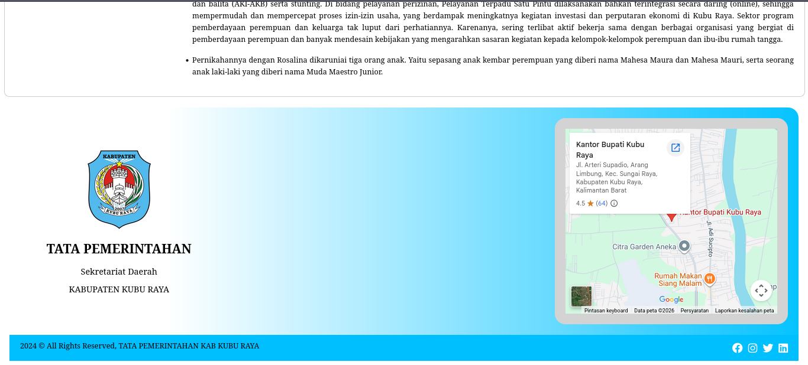
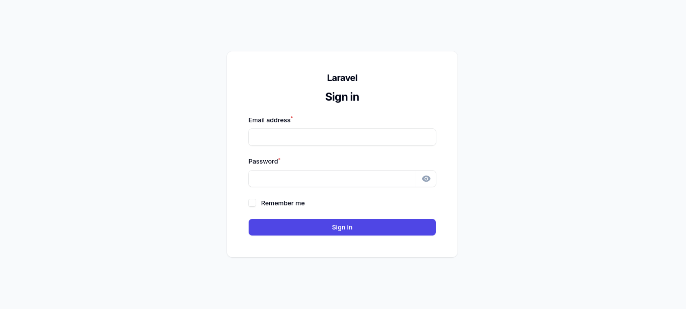
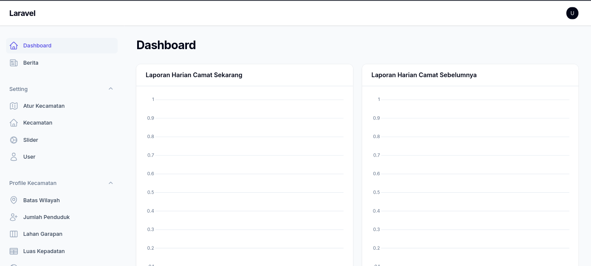

<div align="center">
  

# 🏛️ Bupati Project

**A modern and elegant web application built with the TALL stack (Tailwind, Alpine, Laravel, Livewire/Filament).**

[](https://laravel.com)
[](https://php.net)
[](https://filamentphp.com)
[](https://tailwindcss.com)

---

</div>

## 📖 About The Project

**Bupati** is a comprehensive information system and management dashboard designed to streamline administrative workflows. Powered by the robust **Laravel 11** framework and the elegant **Filament** administration panel, this application offers a seamless user experience, responsive design, and high performance.

### ✨ Key Features

- **Intuitive Dashboard:** A sleek, user-friendly administrative interface powered by Filament.
- **Secure Architecture:** Built on Laravel's battle-tested security paradigms.
- **Modern UI/UX:** Styled completely with Tailwind CSS for a responsive, mobile-first design.
- **High Performance:** Assets compiled lightning-fast using Vite.
- **Media & Document Handling:** Integrated with Puppeteer, Spatie Browsershot, and Intervention Image for advanced media manipulation and reporting.

---

## 📸 Screenshots

<div align="center">
  <table>
    <tr>
      <td align="center">
        <a href="#">
          
        </a>
        <br>
        <em>Landing Page</em>
      </td>
      <td align="center">
        <a href="#">
          
        </a>
        <br>
        <em>Landing Page</em>
      </td>
    </tr>
    <tr>
      <td align="center">
        <a href="#">
          
        </a>
        <br>
        <em>Landing Page</em>
      </td>
      <td align="center">
        <a href="#">
          
        </a>
        <br>
        <em>Landing page</em>
      </td>
    </tr>
     <tr>
      <td align="center">
        <a href="#">
          
        </a>
        <br>
        <em>Login Page</em>
      </td>
      <td align="center">
        <a href="#">
          
        </a>
        <br>
        <em>Admin page</em>
      </td>
    </tr>
  </table>
</div>

---

## 🛠️ Built With (Technologies Used)

This project leverages cutting-edge open-source tools and libraries:

### Backend & Core Framework

-  **[Laravel 11](https://laravel.com)** - The core PHP framework.
-  **[PHP 8.2](https://php.net)** - Server-side programming language.
-  **[Filament v3](https://filamentphp.com)** - A collection of tools for rapidly building beautiful TALL stack interfaces.

### Frontend & Styling

-  **[Tailwind CSS](https://tailwindcss.com)** - Utility-first CSS framework for rapid UI development.
-  **[Vite 6](https://vitejs.dev)** - Next Generation Frontend Tooling for asset bundling.
-  **[Alpine.js](https://alpinejs.dev/)** - A rugged, minimal framework for composing JavaScript behavior.

### Utilities & Packages

- **[Puppeteer](https://pptr.dev/) & Spatie Browsershot:** For capturing web pages and generating PDFs/Images.
- **[Intervention Image v3](https://image.intervention.io/):** For image handling and manipulation.
- **[Barryvdh DOMPDF](https://github.com/barryvdh/laravel-dompdf):** HTML to PDF converter for Laravel.

---

## 🚀 Getting Started

To get a local copy up and running, follow these simple steps.

### Prerequisites

- PHP >= 8.2
- Composer
- Node.js & NPM
- MySQL / PostgreSQL

### Installation

1. **Clone the repository**

    ```bash
    git clone https://github.com/your_username/bupati.git
    ```

2. **Install PHP Dependencies**

    ```bash
    composer install
    ```

3. **Install NPM Packages**

    ```bash
    npm install
    ```

4. **Environment Setup**

    ```bash
    cp .env.example .env
    php artisan key:generate
    ```

5. **Configure Database**
   Update your `.env` file with your database credentials, then run:

    ```bash
    php artisan migrate
    ```

6. **Build Assets & Run Server**
    ```bash
    npm run dev
    php artisan serve
    ```

---

<div align="center">
  <p>Made with ❤️ for the Bupati Project.</p>
</div>
